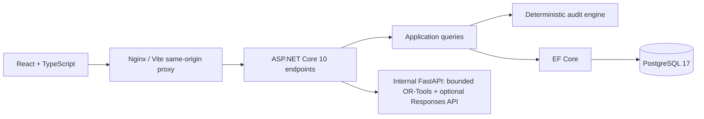

# DegreePilot AI

A local academic advising demonstration themed around **Blue Mountain State University**, the fictional university from the show *Blue Mountain State*. It contains a React/Tailwind dashboard, authenticated ASP.NET Core API, PostgreSQL persistence, deterministic audits and eligibility, validated semester planning, and an optional evidence-grounded advisor. All people, transcripts, courses, and policies are fabricated. This is an unofficial fan demo, not official academic advice.

Start with the [two-minute demo](docs/DEMO_WALKTHROUGH.md), [implemented architecture and access matrix](docs/ARCHITECTURE.md), and [Phase 4 security review/limitations](docs/PHASE4_HARDENING.md). GitHub Actions runs the same local checks without model credentials or deployment steps; hosted execution awaits an approved push.

## Run locally

Install and start Docker Desktop with Linux containers. From the repository root:

```sh
docker compose up --build
```

Open **http://localhost:8080** once the services are healthy. The first build downloads dependencies and container images, including the internal Python planner. No OpenAI account, API key, or paid call is needed.

Select **Ava Chen** and enter **`Local-Demo-Only!2026`**, the default public demo password.

| Username | Access in this slice |
| --- | --- |
| `student-ava` | Own records: **35 / 120 credits**, six of thirteen core courses complete |
| `student-noah` | Own records: **7 / 120 credits**; CS102 D earns no credit |
| `advisor-morgan` | Assigned Ava only: read audit/transcript/plans and send validated suggestions |
| `admin-robin` | Assignment, catalog/policy review, fictional section seats and audit/health; no transcript access |

Configuration is optional. Copy [.env.example](.env.example) to `.env` **only if a local file does not already exist**, then edit overrides before first startup. An existing `.env` takes precedence over these defaults. Keep local secrets out of Git.

```sh
docker compose ps
curl http://localhost:8080/api/health
curl http://localhost:8080/health/ready
docker compose down
```

Stopping with `down` preserves the database volume. Web and database ports bind only to loopback; the API is reached through the web proxy. Set `WEB_PORT` in `.env` if 8080 is occupied. PostgreSQL uses local port 5432.

The development API applies four EF Core migrations and seeds 36 courses, one catalog/program, four accounts, two student profiles, thirteen transcript attempts, three terms, nineteen sections, and nine approved sections from two policy documents. Restarting does not duplicate records, reset passwords, or erase saved plans. Changing `DEMO_PASSWORD` after seeding does not update existing passwords. Editing an already seeded catalog fixture under the same version causes startup to fail; future catalog changes must use a new version.

## Architecture



- [apps/web](apps/web): React + TypeScript + Vite + Tailwind CSS 4; dashboard, audit, transcript, searchable eligibility explorer, and manual/solver semester planner. The sole stylesheet is Tailwind's import and theme tokens; component styling uses utilities.
- [services/api/Domain](services/api/Domain): transport-independent catalog validation, earned-credit/core audit, AND-of-OR eligibility, half-open conflict checks, and independent plan validation.
- [services/api/Application](services/api/Application): queries scoped to the authenticated student and pinned catalog.
- [services/api/Persistence](services/api/Persistence): EF Core schema/migration, validated idempotent seeds, and catalog fingerprint protection.
- [services/api/Transport](services/api/Transport): endpoint and object-level authorization, login, logout, and health checks.
- [tests/DegreePilot.Api.Tests](tests/DegreePilot.Api.Tests): domain/HTTP tests using temporary relational SQLite databases and a separate real PostgreSQL migration/restart test.
- [services/ai](services/ai): private FastAPI planner and optional OpenAI Responses API client. It receives minimal planning options or anonymous academic facts and approved evidence. The browser cannot access it directly; there is no published host port or browser API key.

Credits require C or better, count once per course, and use the most recent passing attempt. All letter-graded attempts, including D/F and repeats, affect demo GPA. P requires explicit elective-category approval; the supplied policy grants none. Four disjoint buckets, all thirteen core courses, and the 120-credit minimum must all be satisfied. Missing, unknown, malformed, or mismatched requirements yield `CATALOG_INVALID`.

Authentication uses ASP.NET cookies and Identity password hashing. State-changing requests require antiforgery tokens. Cookies are HttpOnly, SameSite Strict, and secure outside local environments. No browser API secrets, localStorage session tokens, permissive CORS, or transcript/request-body logging are used. Demo authentication is rejected outside Development/Testing. Advisors require a current explicit assignment on every student-target request. Admin permissions alone never grant transcript access. Mutations are audited atomically. This is not production SSO or a compliance certification. Recreating the API container can invalidate local sessions.

## Native development

Install .NET 10 SDK, Node.js 22.12+, and Python 3.12+; Node 22.20 and Python 3.12 were used here. PostgreSQL can run in Docker.

```sh
dotnet restore DegreePilot.slnx
dotnet tool restore
npm --prefix apps/web ci
docker compose up -d postgres
```

Create the planner environment from the root (PowerShell/Windows):

```powershell
py -3.12 -m venv services/ai/.venv
services/ai/.venv/Scripts/python.exe -m pip install -r services/ai/requirements.txt
services/ai/.venv/Scripts/python.exe -m uvicorn app.main:app --app-dir services/ai --host 127.0.0.1 --port 8000 --no-access-log
```

On macOS/Linux, create the environment with `python3 -m venv services/ai/.venv` and use `services/ai/.venv/bin/python` for the same commands. Run the planner, API, and frontend in separate terminals. The native API defaults to planner URL `http://127.0.0.1:8000/`; override with `Planner__BaseUrl` if needed. The container API uses the private Compose hostname instead.

In PowerShell, set values matching your local Compose database configuration:

```powershell
$env:ASPNETCORE_ENVIRONMENT = 'Development'
$env:Demo__Enabled = 'true'
$env:Demo__Password = 'Local-Demo-Only!2026'
$env:ConnectionStrings__Database = 'Host=127.0.0.1;Database=degreepilot;Username=degreepilot;Password=local-fictional-database-only'
dotnet run --project services/api --no-launch-profile --urls http://127.0.0.1:5080
```

In another terminal:

```sh
npm --prefix apps/web run dev
```

Open http://127.0.0.1:5173. Vite proxies API/health requests to 5080 on the same origin. On macOS/Linux, use shell `export` for the same configuration values. The native API does not automatically load Compose's `.env`.

## Verification

After restoring dependencies, run from the root:

```sh
dotnet build DegreePilot.slnx --no-restore
dotnet test DegreePilot.slnx --no-build --no-restore
dotnet format DegreePilot.slnx --verify-no-changes --no-restore
npm --prefix apps/web run lint
npm --prefix apps/web run test
npm --prefix apps/web run build
docker compose exec -T planner python -m pytest -q -p no:cacheprovider
docker compose exec -T planner python -m ruff check app tests
```

PowerShell users can run build, test, and lint checks with `./scripts/verify.ps1`. It runs Python tests and Ruff from the planner virtual environment when available, or from the running Compose planner if that environment is unavailable. The separate PostgreSQL and browser checks still need running services. The default backend suite uses temporary SQLite and explicitly skips the PostgreSQL-specific test unless a connection is supplied.

The Python suite can also run from the root with `services/ai/.venv/Scripts/python.exe -m pytest -q -c services/ai/pyproject.toml services/ai/tests` (use the `bin/python` path on macOS/Linux).

If Windows marks the downloaded script unsigned, inspect it first, then use a process-only exception: `powershell -NoProfile -ExecutionPolicy Bypass -File scripts/verify.ps1`. This does not change the machine execution policy. Alternatively run the individual commands above.

With the Compose database running:

```powershell
./scripts/test-postgres.ps1
```

This resolves Compose database settings without printing credentials. Alternatively, set `DEGREEPILOT_TEST_DATABASE` to a local PostgreSQL connection with CREATEDB permission and run `dotnet test DegreePilot.slnx --no-restore`. The test creates a unique temporary database, applies migrations, checks repeated startup/seeding and authorization, and drops only that database in cleanup.

Start the full stack before running browser smoke tests:

```sh
cd apps/web
npx playwright install chromium
npm run test:e2e
```

To use installed Edge in PowerShell, set `$env:PLAYWRIGHT_CHANNEL = 'msedge'` and omit browser installation. Set `BASE_URL` for a different port and `DEMO_PASSWORD` for an overridden seeded password. Set `CAPTURE_SCREENSHOTS=1` to save real desktop and 320px mobile captures under [docs/screenshots](docs/screenshots). Keep `AI_ADVISOR_ENABLED=false` for browser tests; they check the real missing-key UI and policy library without making model requests. The checks cover keyboard navigation, both students, cross-student denial, planning, and overflow; Phase 4 checks also cover advisor suggestions/student acceptance, assignment revocation, versioned catalog/policy publication, safe audit history and role-specific controls.

See [the implementation log](docs/IMPLEMENTATION_LOG.md) for executed commands, actual results, and limits.

Verified captures: [desktop login](docs/screenshots/login-desktop.png) · [mobile login](docs/screenshots/login-mobile.png) · [desktop dashboard](docs/screenshots/dashboard-desktop.png) · [320px mobile dashboard](docs/screenshots/dashboard-mobile.png).

## Academic demo steps

1. Sign in as Ava: **35 / 120 credits**, **23 / 44 core credits**, **12 / 36 general education credits**, **3.37 demo GPA**.
2. Open Degree audit: CS210, CS220, CS301, CS310, CS330, CS401, and STAT201 remain. Each category minimum is shown independently.
3. Review all ten attempts in My transcript and the 36 Course catalog descriptions.
4. Sign out and sign in as Noah: **7 credits**, **2.64 demo GPA**, CS102 still required.
5. As Noah, request `/api/students/student-ava/transcript`: expect 404. Adding `?studentId=student-ava` to the `/me` audit still returns Noah's data.
6. In Course catalog, search CS301: Ava is eligible in Spring 2027. CS401 is blocked by CS301 and CS310. Eligibility reasons also explain missing published offerings.
7. Open Semester planner, choose Spring 2027 and 12–12 credits, then Generate proposal. Review the validated weekly timetable and Save plan. Manual selections that overlap or duplicate a course are rejected.
8. Select Spring 2028 (projected): course choices are labeled tentative, with no published meeting times or conflict-free timetable claim.
9. Open AI advisor: with default settings, sending is disabled and the approved policy library remains readable. Expand `CAT-PREREQ-CS401` to inspect its actual source text.

## Phase 2 planning behavior

See [the Phase 2 contract and examples](docs/PHASE2_PLANNING.md). Preferred weekdays and fewer campus days are soft objectives. Credit bounds, unique courses, prior-term C-or-better prerequisites, seats, and published meeting conflicts are hard constraints. The solver has a five-second solve limit. `TIMEOUT` does not mean `INFEASIBLE`; an unavailable service leaves manual validation/saving available. Every solver proposal and save is validated against the authorized student's pinned catalog and current database data. Saved plans are revalidated when read; they reserve no seats.

The 2028 Spring term is an added synthetic unpublished fixture. Existing catalog rules and fingerprints are unchanged. Only course patterns are projected; no multi-semester optimization or academic predictions are implemented.

## Scope and specifications

**Phases 0–4 are implemented.** Phase 5 research remains unimplemented. Advisor assignments, admin versioned workflows, safe audit history, rate limits, CI and browser/accessibility smoke checks are included. See [Phase 4 security review and limitations](docs/PHASE4_HARDENING.md), [implemented architecture](docs/ARCHITECTURE.md) and the [two-minute walkthrough](docs/DEMO_WALKTHROUGH.md). No deployment, push, paid model call, or real student-data integration was performed.

## Optional Phase 3 advisor

See [the advisor contract, grounding boundary, and privacy limits](docs/PHASE3_ADVISOR.md). The policy library works without credentials. Sending chat requires both `AI_ADVISOR_ENABLED=true` and a nonempty `OPENAI_API_KEY` in the private Python service. The default configurable `OPENAI_MODEL` is `gpt-4.1-mini`. Keep these settings in your existing ignored local environment; no key belongs in frontend variables.

After deliberately configuring the provider, recreate the private service with `docker compose up -d --force-recreate planner`. A subsequent deliberate chat request can incur provider charges. This implementation was tested with mocks only. The SDK uses Responses structured output, no tools, no automatic retries, a 20-second timeout, and at most 1800 output tokens. The chat endpoint allows five questions per student per minute by default; deterministic endpoints have no advisor budget restriction.

The model selects a brief or detailed grounded draft assembled from approved policy excerpts and deterministic facts. Both services reject altered academic claims or citation IDs. This intentionally limits free paraphrasing. Unsupported policies abstain. All source retrieval is scoped to the authenticated student's pinned catalog. Chats stay in page memory and can be cleared; source/record changes during a response cause abstention.

Sources of truth: [repository instructions](AGENTS.md), [master prompt](CODEX_MASTER_PROMPT.md), [product requirements](docs/PRODUCT_REQUIREMENTS.md), [architecture](docs/ARCHITECTURE.md), [domain rules](docs/DOMAIN_RULES.md), [phase gates](docs/IMPLEMENTATION_PHASES.md), [test plan](docs/TEST_PLAN.md), [UI blueprint](docs/UI_BLUEPRINT.md), [AI/security design](docs/AI_AND_SECURITY.md), [fixtures](data), [fictional policies](policies), and [follow-up prompts](prompts/PHASE_PROMPTS.md).
