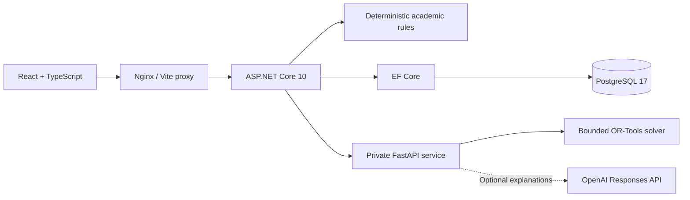

# DegreePilot AI

An academic advising application with deterministic degree audits, course eligibility checks, semester scheduling, a multi-semester research planner, and an optional evidence-grounded AI advisor.

The interface is themed around **Blue Mountain State University**, the fictional university from the television series. All people, transcripts, courses, and policies are fabricated. This is an unofficial demonstration, not official academic advice. See [image sources and notices](ASSET_NOTICES.md).

## Run locally

Install Docker Desktop with Linux containers, then run from the repository root:

```sh
docker compose up --build
```

Open **http://localhost:8080** after the services become healthy. Sign in as **Ava Chen** using **`Local-Demo-Only!2026`**, the public demo password.

| Username | Access |
| --- | --- |
| `student-ava` | Own records: 35 of 120 credits earned |
| `student-noah` | Own records: 7 of 120 credits earned; CS102 still required |
| `advisor-morgan` | Ava's assigned advisor: audit, transcript, plans, and validated suggestions |
| `admin-robin` | Assignments, catalog and policy publication, section seats, audit history, and service health |

No model credentials are required for audits or planning. To customize settings, copy [.env.example](.env.example) to `.env` **only if `.env` does not already exist**. Keep credentials in the ignored local file. Set `WEB_PORT` if port 8080 is occupied.

```sh
docker compose ps
curl http://localhost:8080/api/health
curl http://localhost:8080/health/ready
docker compose down
```

Stopping with `down` preserves the database volume. Web and database ports bind to loopback; the API is reached through the web proxy. PostgreSQL uses local port 5432. Demo authentication is restricted to Development/Testing environments.

Startup applies four EF Core migrations and seeds the fictional catalog, accounts, transcripts, terms, sections, and approved policy sources. Restarting preserves saved plans and existing passwords. Changing `DEMO_PASSWORD` after initial seeding does not change stored passwords. Catalog editions are immutable: changes require a new version rather than silently changing a student's catalog-year rules.

## Architecture



| Directory | Responsibility |
| --- | --- |
| [apps/web](apps/web) | React, TypeScript, Vite, and Tailwind UI; role-specific workspaces |
| [services/api/Domain](services/api/Domain) | Catalog validation, audits, prerequisites, conflicts, and independent plan validation |
| [services/api/Application](services/api/Application) | Authorized queries, planning, policy retrieval, and administration |
| [services/api/Persistence](services/api/Persistence) | EF Core migrations, idempotent seeds, and catalog fingerprints |
| [services/api/Transport](services/api/Transport) | Authentication, endpoint authorization, and health checks |
| [services/ai](services/ai) | Private planning service and optional grounded explanations |
| [tests/DegreePilot.Api.Tests](tests/DegreePilot.Api.Tests) | Domain and HTTP tests with temporary relational databases |
| [benchmarks/degree_planning](benchmarks/degree_planning) | Synthetic benchmark inputs, results, traces, and analysis |

The API owns academic records and authorization. Students can read only their own data; advisors need an active assignment for each student-targeted request. Admin permissions do not grant transcript access. Authentication uses ASP.NET cookies and Identity password hashing, and mutations require antiforgery tokens. The private Python service has no database credentials or published host port. No provider key is sent to the browser.

## Academic rules and planning

Credits require C or better and count once per course. The most recent passing attempt satisfies requirements, while all letter-graded attempts, including D/F and repeats, affect the demo GPA. A degree audit checks four disjoint credit buckets, thirteen required core courses, and a 120-credit minimum against the student's pinned catalog. Missing or malformed requirements fail validation.

Prerequisites use AND-of-OR groups and must be completed before the planned term. Semester proposals enforce credit bounds, unique courses, seats, and published meeting conflicts. Weekday preferences and fewer campus days are soft objectives. Every solver proposal and saved plan is independently validated by the API. Saved plans reserve no seats and are revalidated when read. A solver outage leaves manual validation and saving available. Timeout and infeasibility are separate results.

The multi-semester research planner schedules a conditional roadmap across up to twelve semesters. Published sections retain seat and conflict constraints; unpublished terms are labeled tentative. Future passing grades are assumptions and never become transcript records. The planner makes no graduation-delay predictions or academic outcome probability estimates.

## Optional AI advisor

Audits and planning work without an API key. Chat requires both `AI_ADVISOR_ENABLED=true` and a nonempty `OPENAI_API_KEY` in the private planner service. The configurable default model is `gpt-4.1-mini`. After configuring `.env`, recreate that service:

```sh
docker compose up -d --force-recreate planner
```

Sending chat with a valid provider configuration can incur charges. Automated tests mock provider traffic and use fabricated records.

The advisor explains deterministic academic facts using approved policy passages scoped to the student's catalog. The model selects a reviewed draft; the server supplies the answer and exact citations. Both services validate responses, and changed facts or sources cause abstention. Unsupported policies and provider failures return explicit unavailable or clarification states. The advisor cannot edit grades, catalog rules, or plans.

The provider client uses a 20-second timeout, no automatic retries, no tools, `store=False`, and a bounded output budget. Chat is limited to five questions per student per minute by default. Conversations remain in page memory and can be cleared. This constrained explanation interface is not unrestricted academic counseling or production SSO.

## Native development

Install .NET 10 SDK, Node.js 22.12+, and Python 3.12+. Restore dependencies and start PostgreSQL:

```sh
dotnet restore DegreePilot.slnx
dotnet tool restore
npm --prefix apps/web ci
docker compose up -d postgres
```

Create and run the planner environment from the root in PowerShell:

```powershell
py -3.12 -m venv services/ai/.venv
services/ai/.venv/Scripts/python.exe -m pip install -r services/ai/requirements.txt
services/ai/.venv/Scripts/python.exe -m uvicorn app.main:app --app-dir services/ai --host 127.0.0.1 --port 8000 --no-access-log
```

In another terminal, use credentials matching your local database configuration:

```powershell
$env:ASPNETCORE_ENVIRONMENT = 'Development'
$env:Demo__Enabled = 'true'
$env:Demo__Password = 'Local-Demo-Only!2026'
$env:ConnectionStrings__Database = 'Host=127.0.0.1;Database=degreepilot;Username=degreepilot;Password=local-fictional-database-only'
dotnet run --project services/api --no-launch-profile --urls http://127.0.0.1:5080
```

Run `npm --prefix apps/web run dev` in a third terminal and open http://127.0.0.1:5173. Vite proxies API requests to port 5080. The native API defaults to planner URL `http://127.0.0.1:8000/`; override `Planner__BaseUrl` if needed. It does not automatically load Compose's `.env`.

On macOS/Linux, create the virtual environment with `python3 -m venv services/ai/.venv`, use its `bin/python`, and set environment variables with `export`.

## Verification

After restoring dependencies, run the local build, test, formatting, lint, and privacy checks:

```powershell
powershell -NoProfile -ExecutionPolicy Bypass -File scripts/verify.ps1
```

The script uses the planner virtual environment when available, otherwise the running Compose planner. Tests use temporary SQLite databases; the PostgreSQL-specific test is skipped unless a test connection is supplied. With the Compose database running, execute that check separately:

```powershell
./scripts/test-postgres.ps1
```

It creates a unique temporary database, applies migrations, checks seeding/restart behavior and authorization, then removes that test database.

With the full stack running and the advisor disabled, run browser checks:

```sh
cd apps/web
npx playwright install chromium
npm run test:e2e
```

Set `BASE_URL` for a different web port and `DEMO_PASSWORD` for an overridden seeded password. On Windows, `PLAYWRIGHT_CHANNEL=msedge` uses installed Edge. Keep `AI_ADVISOR_ENABLED=false` for browser tests to avoid paid model requests. GitHub Actions runs build, test, privacy, PostgreSQL, and browser checks without provider credentials.

## Try the application

1. Sign in as Ava and open Degree audit: 35 of 120 credits earned, 23 of 44 core credits, 12 of 36 general education credits, and a 3.37 demo GPA.
2. Search the course catalog: Ava is eligible for CS301 in Spring 2027; CS401 still requires CS301 and CS310.
3. Generate a Spring 2027 semester plan with a 12-credit minimum and maximum, review its validated timetable, and save it.
4. Generate a multi-semester roadmap and inspect tentative future offerings and remaining requirements.
5. Open AI advisor. Without provider configuration, chat is disabled while audits and planning remain available. When enabled, ask about prerequisites or degree progress and inspect the cited passages.
6. Sign in as Noah: 7 credits earned and CS102 still required. His session cannot access Ava's records.

Dashboard captures: [desktop](docs/screenshots/dashboard-desktop.png) and [mobile](docs/screenshots/dashboard-mobile.png).

## Reproduce the research benchmark

```powershell
services/ai/.venv/Scripts/python.exe scripts/benchmark_degree.py
services/ai/.venv/Scripts/python.exe scripts/evaluate_degree_benchmark.py
dotnet test DegreePilot.slnx --no-restore --filter FullyQualifiedName~DegreePlanningTests
```

On Linux, use the virtual environment's `bin/python`. The checked-in run contains 22 synthetic cases, three repetitions per algorithm, and 132 runs. All 69 feasible traces passed independent Python and ASP.NET replay checks, with zero recorded invariant violations. These fixture results are not real-world accuracy estimates. Inspect the [analysis notebook](benchmarks/degree_planning/analysis.ipynb), [results](benchmarks/degree_planning/results.csv), and [manifest](benchmarks/degree_planning/manifest.json) for measurements and limitations.
