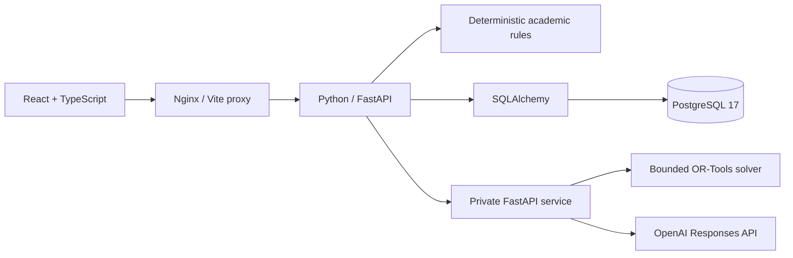

# DegreePilot AI

An academic advising application with deterministic degree audits, course eligibility checks, semester scheduling, a multi-semester research planner, and an evidence-grounded AI advisor.

The interface is themed around **Blue Mountain State University**, the fictional university from the television series. All people, transcripts, courses, and policies are fabricated. This is an unofficial demonstration, not official academic advice.

## Demo
A complete 5-minute walkthrough of the application.
[▶ Watch the Demo Video](https://www.youtube.com/watch?v=7QWS3bD_vqo))
Dashboard captures: [desktop](docs/screenshots/dashboard-desktop.png) and [mobile](docs/screenshots/dashboard-mobile.png).

## Run locally

Install Docker Desktop with Linux containers, then run from the repository root:

```sh
docker compose up --build
```

Open **http://localhost:8080** after the services become healthy. Sign in as **Ava Chen** using **`Local-Demo-Only!2026`**, the public demo password.

| Username | Access |
| --- | --- |
| `student-ava` | Own records: 35 of 120 credits earned |
| `student-noah` | Own records: 7 of 120 credits earned; CS102 still required |
| `advisor-morgan` | Ava's assigned advisor: audit, transcript, plans, and validated suggestions |
| `admin-robin` | Assignments, catalog and policy publication, section seats, audit history, and service health |

Startup applies Alembic migrations and seeds the fictional catalog, accounts, transcripts, terms, sections, and approved policy sources. Restarting preserves saved plans and existing passwords. Changing `DEMO_PASSWORD` after initial seeding does not change stored passwords. Catalog editions are immutable: changes require a new version rather than silently changing a student's catalog-year rules.

## Architecture



| Directory | Responsibility |
| --- | --- |
| [apps/web](apps/web) | React, TypeScript, Vite, and Tailwind UI; role-specific workspaces |
| [services/api/degreepilot_api](services/api/degreepilot_api) | FastAPI routes, deterministic academic rules, authorization, administration, and grounded advising |
| [services/api/migrations](services/api/migrations) | Alembic schema migrations with adoption of the existing database |
| [services/ai](services/ai) | Private planning service and grounded explanations |
| [tests/api](tests/api) | Domain, HTTP, authorization, migration, and database tests |
| [benchmarks/degree_planning](benchmarks/degree_planning) | Synthetic benchmark inputs, results, traces, and analysis |

The API owns academic records and authorization. Students can read only their own data; advisors need an active assignment for each student-targeted request. Admin permissions do not grant transcript access. Authentication uses signed HttpOnly session cookies and Argon2 password hashes through pwdlib. Mutations require a session-bound CSRF token and reject cross-origin requests. Sessions expire after two hours; user roles and advisor assignments are checked against the database. The private Python service has no database credentials or published host port. No provider key is sent to the browser.

## Academic rules and planning

Credits require C or better and count once per course. The most recent passing attempt satisfies requirements, while all letter-graded attempts, including D/F and repeats, affect the demo GPA. A degree audit checks four disjoint credit buckets, thirteen required core courses, and a 120-credit minimum against the student's pinned catalog. Missing or malformed requirements fail validation.

Prerequisites use AND-of-OR groups and must be completed before the planned term. Semester proposals enforce credit bounds, unique courses, seats, and published meeting conflicts. Weekday preferences and fewer campus days are soft objectives. Every solver proposal and saved plan is independently validated by the API. Saved plans reserve no seats and are revalidated when read. A solver outage leaves manual validation and saving available. Timeout and infeasibility are separate results.

The multi-semester research planner schedules a conditional roadmap across up to twelve semesters. Published sections retain seat and conflict constraints; unpublished terms are labeled tentative. Future passing grades are assumptions and never become transcript records. The planner makes no graduation-delay predictions or academic outcome probability estimates.

## Try the application

1. Sign in as Ava and open Degree audit: 35 of 120 credits earned, 23 of 44 core credits, 12 of 36 general education credits, and a 3.37 demo GPA.
2. Search the course catalog: Ava is eligible for CS301 in Spring 2027; CS401 still requires CS301 and CS310.
3. Generate a Spring 2027 semester plan with a 12-credit minimum and maximum, review its validated timetable, and save it.
4. Generate a multi-semester roadmap and inspect tentative future offerings and remaining requirements.
5. Open AI advisor. Ask about prerequisites or degree progress and inspect the cited passages.
6. Sign in as Noah: 7 credits earned and CS102 still required. His session cannot access Ava's records.
